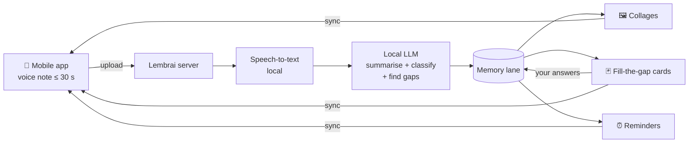

# Lembrai

> *Recordar é viver.* (To remember is to live.)

**Lembrai** is a self-hosted, voice-first **memory lane**. Most of life never gets photographed: the conversation with an old friend, the dish you loved, the street where you got lost. Lembrai lets you speak those moments into your phone, turns them into memory cards with a **local LLM**, and over time builds them into a personal timeline you can walk back through.

Think of it as [Immich](https://github.com/immich-app/immich) for the memories that aren't in your photos. Like Immich, Lembrai brings old moments back to you as **collages** from time to time. Unlike a photo library, it also asks you to **fill in what's missing**, so each memory gets richer the more you use it.

Because it already understands what you say, it can also handle the everyday stuff: reminders, places to try, facts about people.

> [!WARNING]
> **Pre-alpha.** The project is in the design phase. Nothing is usable yet. Star or watch the repo to follow along.

---

## Why

- Memories shouldn't live only in photos. Most of what matters is never captured in one.
- Speaking a memory takes seconds. Writing a journal entry rarely happens.
- A single voice note is half a memory. Who was there, where it was and how it felt usually come back later, if something asks.
- Hosted journaling and voice-note apps send your life to someone else's cloud and LLM.

Lembrai is meant to be **private by default**: audio, transcripts and summaries never leave your hardware.

## What it does

| Feature | What you get                                                                                                                                                                 |
|---|------------------------------------------------------------------------------------------------------------------------------------------------------------------------------|
| 🎙️ **Capture** | Hold to record a voice note of up to 30 seconds. One thought per note.                                                                                                       |
| 🧠 **Understand** | A local LLM summarises the note, picks a category and extracts people, places and dates.                                                                                     |
| 🕰️ **Memory lane** | Every memory lands on a personal timeline you can browse by date, person or place.                                                                                           |
| 🖼️ **Collages** | From time to time, Lembrai builds a collage of related memory cards, such as *"One year ago"*, *"Evenings with Friends"* or *"Lisbon, spring 2025"*, and shows it to you.    |
| 🃏 **Fill-the-gap flashcards** | Lembrai shows a memory card and asks for the details it lacks: *"Who else was at the dinner?"*, *"What was the restaurant called?"* Your answers are merged into the memory. |
| ⏰ **Everyday helpers** | The same pipeline handles reminders with due dates, places to visit and facts about people.                                                                                  |

> [!NOTE] Scope of the first iteration
> The first iteration stores every memory as a **text flashcard** only. The voice note is used to create the card and is not kept with it.
> The memory model is designed to grow into **multimedia**: replaying the original voice note, attaching photos and building collages that mix cards with media. See [[#Roadmap]].

## How it works



1. **Capture**: hold to record in the mobile app. Notes are capped at **30 seconds**, which keeps each one to a single thought.
2. **Upload**: the app queues notes offline and syncs them when the server is reachable.
3. **Transcribe**: the server converts speech to text locally.
4. **Understand**: a local LLM writes a one-line summary, picks a category and extracts structured fields such as names, places and dates. It also notes which fields are still missing.
5. **Build the lane**: the memory is added to your timeline as a flashcard and linked to the people and places it mentions.
6. **Resurface**: Lembrai periodically groups related memories into collages and shows them to you.
7. **Enrich**: fill-the-gap flashcards ask you for the missing details. Every answer makes the memory more complete.

> [!TIP]
> Over months, a quick *"Dinner with Ravi tonight"* can grow into a full memory: who was there, which restaurant, what you talked about and how it felt.

## Categories (initial)

Memories are the core. The other categories reuse the same pipeline for everyday tasks.

| Category | Example voice note | Extracted fields | Follow-up the app might ask |
|---|---|---|---|
| 💭 Memories | "Met my old colleague Ravi today" | people, date, place | "Where did you meet?" |
| 📍 Places | "That ramen place near Rossio was amazing" | place, location, rating | "What did you order?" |
| 🍺 Tastes & discoveries | "Tried a new beer called ABS, really hoppy" | item, type, opinion | "Where did you have it?" |
| 👤 People | "Ravi's daughter is called Meera" | person, fact | "How old is Meera?" |
| ⏰ Reminders | "My insurance is due on 14 March" | what, due date | — |
| 🗂️ Other | anything else | free text | — |

Categories will be user-extensible. The LLM classifies a note into the list you define.

## Components

| Component | Description | Status |
|---|---|---|
| `server/` | API, processing pipeline, collage and flashcard scheduling, and storage, shipped as a Docker image | Planned |
| `mobile/` | Android and iOS client for recording, the memory lane, collages and flashcards | Planned |
| `docker-compose.yml` | One-command self-hosting | Planned |

### Proposed stack

| Concern | Choice (tentative) |
|---|---|
| Server API | Python · FastAPI |
| Speech-to-text | [faster-whisper](https://github.com/SYSTRAN/faster-whisper) |
| Local LLM runtime | [Ollama](https://ollama.com) (any compatible model) |
| Storage | PostgreSQL (local file storage for media once multimedia lands) |
| Mobile | Flutter |
| Deployment | Docker Compose |

The stack is open for discussion. Feedback is welcome in the issues.

## Roadmap

### First iteration: flashcards

- [ ] Server: upload endpoint with 30-second validation
- [ ] Server: transcription pipeline
- [ ] Server: LLM summarisation, classification and missing-field detection
- [ ] Server: flashcard model, timeline and REST API
- [ ] Docker Compose setup
- [ ] Mobile: record and upload, with an offline queue
- [ ] Mobile: memory lane timeline (by date, person, place)
- [ ] Fill-the-gap flashcards that merge answers into memories
- [ ] Periodic collages of flashcards ("one year ago", by person, by place)
- [ ] Reminders that trigger notifications on their due date
- [ ] Search across all memories

### Later: multimedia and more

- [ ] Keep the original voice note with its card and play it back
- [ ] Attach photos to a memory
- [ ] Collages that mix cards, photos and audio
- [ ] Multi-user support

## Future directions

Ideas beyond the roadmap, roughly in order:

- **Pipeline as a graph**: run ingestion as a LangGraph workflow with structured, validated LLM output.
- **Fill-the-gap that pauses and resumes**: the workflow waits for your answer, even days later, then merges it in.
- **Semantic search**: find memories by meaning using embeddings in pgvector.
- **Ask your memories**: answer questions like *"When did I last see Ravi?"*, citing the source cards.
- **Duplicate detection**: merge two notes about the same moment.
- **People and places graph**: recognise the same person or place across memories and link them.
- **Smarter collages**: group related memories into themes automatically.
- **Multimodal**: caption photos with a local vision model and search them with text.
- **MCP server**: let other AI clients query your memories.
- **Evals and tracing**: measure prompt and model changes against a test set, traced with self-hosted Langfuse.

## Self-hosting

*Coming soon.* The target is:

```bash
git clone https://github.com/<you>/lembrai.git
cd lembrai
docker compose up -d
```

## Contributing

The project is just starting, so this is a good time to shape it. Open an issue to discuss ideas, the architecture or category design before sending large PRs.

## Name

*Lembrai* comes from the Portuguese *lembrar* (to remember), used as a command (*lembrai!*, "remember!"), with an **AI** at the end.

## License

Licensed under the [Apache License, Version 2.0](LICENSE).
